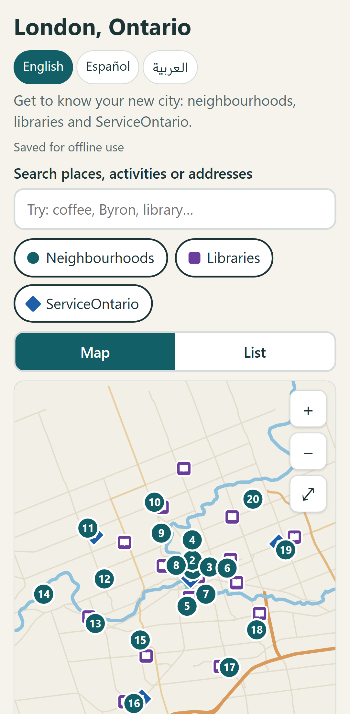
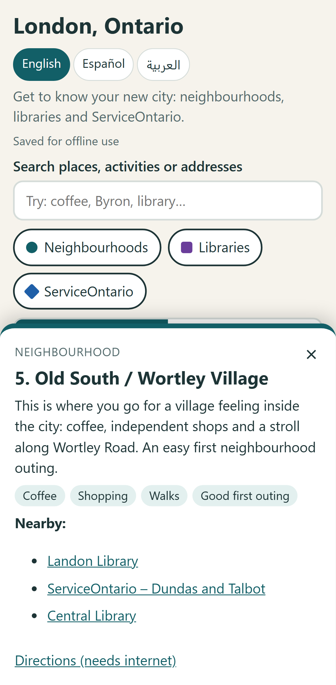
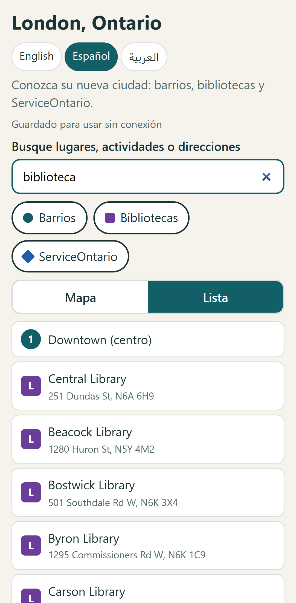
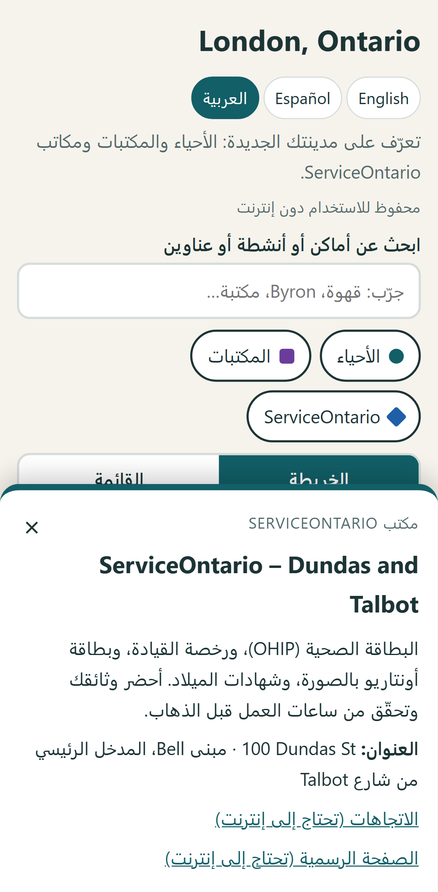
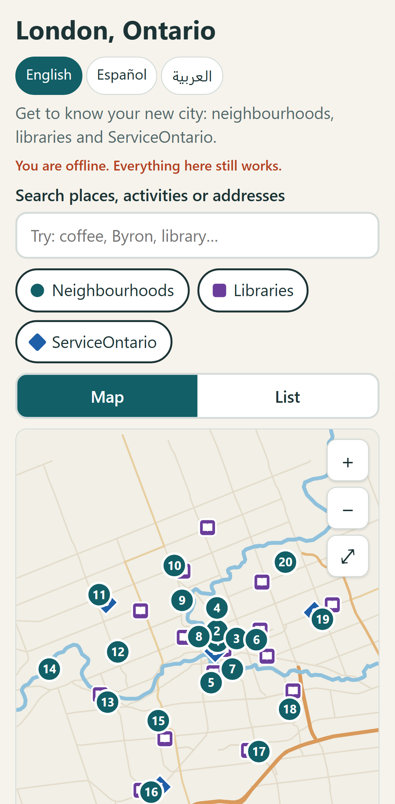
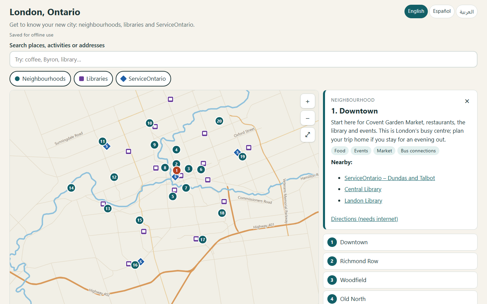
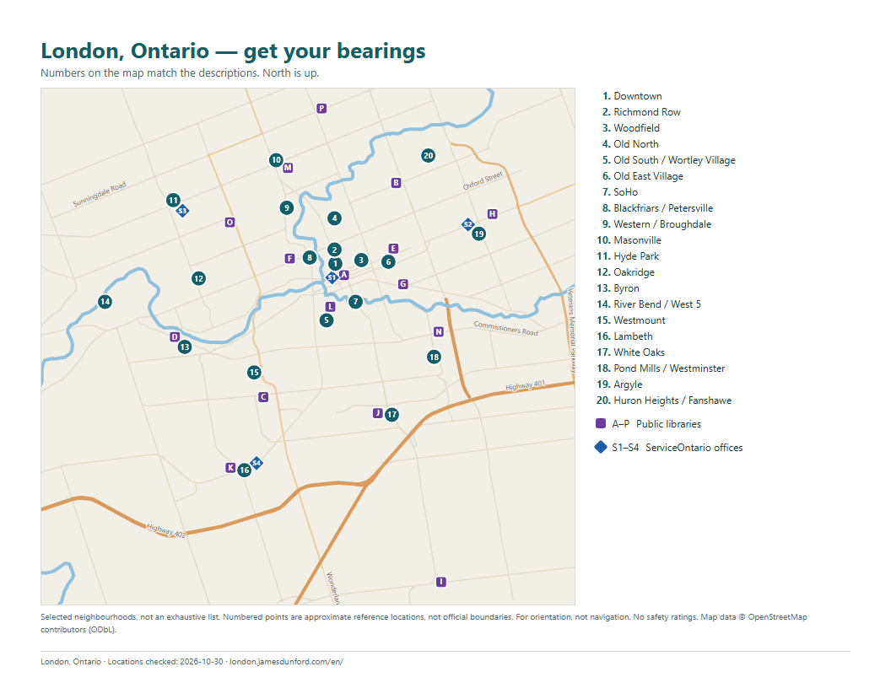

# London Neighbourhoods — Offline-First Newcomer Guide

[](https://london.jamesdunford.com)


An interactive, **offline-first** guide to London, Ontario for people who are new to the city. It covers **20 neighbourhoods**, all **16 London Public Library branches** and the **4 ServiceOntario offices** in **English, Spanish and Arabic**. It's built with **Astro**, **TypeScript** and a **custom SVG map built from OpenStreetMap data**, uses a **build-time service worker** for offline use, and generates **printable PDFs** with **Playwright**.

The project came out of volunteering with **Canada Connects** and the **South London Neighbourhood Resource Centre**, where I meet weekly with newcomers so they can practise their English. One couple from Colombia said that one of the hardest parts of arriving was learning the city: what the neighbourhoods are called, where things are, and why you would go there.

This project demonstrates mobile-first UI design, offline-first architecture, internationalization including right-to-left layout, geospatial data processing, accessibility, and generating web and print output from a single source of truth.

**Live Demo:** [https://london.jamesdunford.com](https://london.jamesdunford.com)

---

## 🚀 Features

### 🗺️ Interactive Map
- Custom vector basemap (river, highways and arterial roads) generated from OpenStreetMap
- Pan, pinch-to-zoom, mouse-wheel zoom and keyboard-accessible pins
- Pins stay the same size on screen at every zoom level
- Three layers: neighbourhoods, libraries and ServiceOntario offices, each with its own toggle
- Selecting a place zooms to it and updates the URL (`/en/#byron`), so links can be shared

### 📍 Neighbourhoods & Essential Services
- 20 neighbourhoods described in everyday language: why you'd go, not a safety rating
- All 16 London Public Library branches with verified addresses
- All 4 current ServiceOntario offices (health cards, driver's licences, photo cards)
- "Nearby" links from each neighbourhood to the closest libraries and ServiceOntario offices, worked out from coordinates
- Suggested first outings and practical advice for exploring with confidence

### 🌐 Multilingual (EN / ES / AR)
- English, neutral Latin American Spanish, and Modern Standard Arabic
- Full right-to-left layout for Arabic using CSS logical properties, with no separate stylesheet
- Place and street names stay in English, to match the signs people will actually see
- Switching language keeps the selected place
- Picks the visitor's browser language automatically on first visit

### 🔎 Cross-Language Search
- Search names, descriptions, activities and addresses
- Ignores accents: `cafe` finds `café`
- Category words work in every language on every page: `library`, `biblioteca` and `مكتبة` all find libraries
- Service keywords: `ohip` or `licence` finds ServiceOntario

### 📶 Works Offline
- A service worker saves the entire site after the first visit: every page, the map, the icons and the PDFs
- Opens with no connection, on a bus with no data plan or in a basement with no signal
- Shows the user when they're offline and that everything still works
- Installable to the home screen as a Progressive Web App

### 🖨️ Printable PDF Guide
- A 4-page, letter-size landscape handout for each language
- Map with lettered library pins (A–P) and ServiceOntario pins (S1–S4), matching the address tables
- Generated from the same data and print page as the website, so the paper version never drifts

### 🔒 Privacy by Design
- No tracking, no analytics and no cookies
- Never asks for the user's location
- No backend: nothing to log, nothing to breach

---

## 📸 Screenshots

### 🟦 Mobile: Map, Details & Search
<p>Mobile-first layout with Map/List tabs, a bottom sheet for details, and cross-language search.</p>
<div style="display: flex; gap: 12px; margin-bottom: 20px;">
  
  
  
</div>

### 🟧 Arabic (Right-to-Left) & Offline
<p>The whole interface mirrors for Arabic, and the site keeps working with no connection.</p>
<div style="display: flex; gap: 12px; margin-bottom: 20px;">
  
  
</div>

### 🟨 Desktop
<p>Side-by-side map and details on larger screens.</p>
<div style="display: flex; gap: 12px; margin-bottom: 20px;">
  
</div>

### 🟩 Printable PDF
<p>Page 1 of the handout. Numbers match the descriptions, and letters match the address tables.</p>
<div style="display: flex; gap: 12px; margin-bottom: 20px;">
  
</div>

---

## 🛠️ Tech Stack

### Frontend
| Technology | Purpose |
|------------|---------|
| **Astro 7** | Static site generation, one page per language |
| **TypeScript** | Type safety for data, strings and client logic |
| **Vanilla TS** | Pan/zoom, search and selection (~5 KB, no UI framework) |
| **SVG** | Basemap and pins, sharp at any zoom and in print |
| **CSS logical properties** | One stylesheet that mirrors for right-to-left languages |

### Offline & Print
| Technology | Purpose |
|------------|---------|
| **Service Worker** | Cache-first precache of every build output file |
| **Custom Astro integration** | Writes `sw.js` after each build, with a content-hashed cache version |
| **Web App Manifest** | Install to home screen |
| **Playwright (Chromium)** | Renders the PDFs and app icons from the print page |

### Data
| Technology | Purpose |
|------------|---------|
| **OpenStreetMap / Overpass API** | River and road geometry, plus location coordinates |
| **Douglas–Peucker simplification** | Shrinks the basemap to ~78 KB |
| **JSON data files** | Neighbourhoods and places, the single source of truth |

### Deployment
| Technology | Purpose |
|------------|---------|
| **Vercel** | Static hosting at `london.jamesdunford.com` |
| **GitHub** | Source control; PDFs are committed so the build doesn't need Chromium |

---

## 📦 Data Model

### **Neighbourhood** (`src/data/neighbourhoods.json`)
- `id` (string): URL-safe key, e.g. `wortley-village`
- `lat`, `lon` (number): approximate reference point (not a boundary)
- `tags` (string[]): activities such as `coffee`, `parks` or `errands`, translated in the UI
- `name` (`{ en, es, ar }`): display name; proper nouns stay in English
- `text` (`{ en, es, ar }`): plain-language description of why you'd go

### **Place** (`src/data/places.json`)
- `id` (string): e.g. `lpl-central`, `so-dundas-talbot`
- `type` (`library` | `serviceontario`)
- `name`, `address` (string): official name and street address
- `note` (`{ en, es, ar }`, optional): e.g. "Inside Walmart"
- `lat`, `lon` (number): exact location
- `url` (string, optional): official location page
- `approximate` (boolean, optional): flags a pin that couldn't be placed exactly
- File-level `checked` date and `sources`, shown in the UI and on the PDF

### **Derived at build time** (`src/lib/data.ts`)
- `x`, `y`: projected SVG coordinates
- `n`: map number (1–20) for neighbourhoods
- `code`: print label for places (A–P, S1–S4)
- `nearby`: up to 3 places within 2.5 km of each neighbourhood

---

## 🌐 Routes

| Route | Description |
|-------|-------------|
| `/` | Language picker; redirects to the browser's language when supported |
| `/{lang}/` | Interactive map and list (`en`, `es`, `ar`) |
| `/{lang}/#{id}` | Same page with a place pre-selected |
| `/{lang}/print/` | Print layout, also used to generate the PDFs |
| `/pdf/london-guide-{lang}.pdf` | Downloadable PDF guide |
| `/sw.js` | Service worker, generated at build time |

---

## 🏗️ Project Structure
```
london-neighbourhoods/
├── src/
│   ├── components/
│   │   └── MapSvg.astro          # Basemap + pins (interactive and print)
│   ├── data/
│   │   ├── neighbourhoods.json   # 20 neighbourhoods, EN/ES/AR
│   │   ├── places.json           # Libraries + ServiceOntario
│   │   └── basemap.json          # Generated from OpenStreetMap
│   ├── i18n/
│   │   └── strings.ts            # UI text for all languages
│   ├── layouts/
│   │   └── Base.astro            # <html lang/dir>, manifest, SW registration
│   ├── lib/
│   │   ├── app.ts                # Pan/zoom, search, selection, offline status
│   │   ├── data.ts               # Projection, nearby places, pin nudging, codes
│   │   └── geo.js                # Shared lat/lon → SVG projection
│   ├── pages/
│   │   ├── index.astro           # Language picker
│   │   └── [lang]/
│   │       ├── index.astro       # Main app
│   │       └── print.astro       # Print / PDF layout
│   ├── styles/
│   │   ├── global.css            # Mobile-first, logical properties
│   │   └── print.css             # Letter landscape pages
│   └── sw-template.js            # Service worker template
├── scripts/
│   ├── build-basemap.mjs         # Overpass → simplified SVG paths
│   └── make-assets.mjs           # PDFs + icons via Playwright
├── public/
│   ├── icons/
│   ├── pdf/                      # Generated PDFs (committed)
│   └── manifest.webmanifest
├── docs/screenshots/
├── astro.config.mjs              # Includes the service worker integration
└── README.md
```

---

## 🚀 Running Locally

### **Prerequisites**
- Node.js 20+ (developed on Node 24)

### **Setup**

1. **Clone the repository:**
   ```bash
   git clone https://github.com/JamesD9406/london-neighbourhoods.git
   cd london-neighbourhoods
   ```

2. **Install dependencies:**
   ```bash
   npm install
   ```

3. **Start the development server:**
   ```bash
   npm run dev
   ```
   The site runs at http://localhost:4321

4. **Build and preview the production site** (the service worker only runs in a production build):
   ```bash
   npm run build
   npm run preview
   ```

### **Regenerating Assets**

PDFs and icons (first time only: `npx playwright install chromium`):
```bash
npm run assets
```

Refresh the OpenStreetMap basemap:
```bash
npm run basemap
```

### **Updating Places**
1. Edit `src/data/places.json` and set `"checked"` to today's date
2. Run `npm run assets` so the PDFs pick up the change
3. Commit the data and the regenerated PDFs

Sources: [London Public Library locations](https://www.lpl.ca/locations) · [ServiceOntario locations](https://www.ontario.ca/locations/serviceontario/all-locations)

### **Adding a Language**
1. Add the code to `LANGS` in `src/i18n/strings.ts` and add a strings object for it
2. Add the same key to every `name`, `text` and `note` in the data files
3. Add it to `supported` in `src/pages/index.astro`

---

## 🌐 Deployment (Vercel)

1. **Import the repository** in Vercel. It detects Astro automatically:
   - Build command: `npm run build`
   - Output directory: `dist`

2. **Add the custom domain** `london.jamesdunford.com` in the project's domain settings

3. **Add the DNS record** Vercel provides (a CNAME for the `london` subdomain)

PDFs are committed in `public/pdf/`, so the Vercel build doesn't need Chromium.

---

## 📊 Key Logic

### **Map Projection**
An equirectangular projection, scaled by `cos(latitude)`, maps latitude/longitude to SVG units. At city scale the distortion isn't noticeable, and it keeps the build script and the browser using the same simple maths (`src/lib/geo.js`).

### **Constant-Size Pins**
On every zoom, the script sets `--u` to the number of SVG units per screen pixel. Pins use `scale(calc(var(--u) * 1.25))` and labels use `font-size: calc(11px * var(--u))`, so they stay readable at every zoom without redrawing.

### **Pin Collision Nudging**
Library and ServiceOntario pins are exact; neighbourhood pins are approximate reference points. A short relaxation pass pushes neighbourhood pins (and only those) about 600 m away from anything they overlap, so no place disappears under a number on the map or in print.

### **Offline Caching**
After `astro build`, a custom integration lists every file in `dist/`, hashes their contents, and writes `sw.js` with that list and a versioned cache name. The service worker serves from the cache first. If someone goes offline on a page that wasn't cached, it falls back to that language's main page. The cache lookup uses `ignoreVary`, because module scripts send an `Origin` header that the precached responses don't have.

### **Mobile Tap Handling**
Pointer capture makes dragging smooth, but it sends the tap to the `<svg>` instead of the pin. The pressed pin is recorded on `pointerdown` and selected on `pointerup`. The browser's follow-up click is then ignored, so it can't land on a link in the bottom sheet that just opened under the user's finger.

---

## ♿ Accessibility & Inclusion

1. **Touch targets:** at least 44 px for all controls
2. **Keyboard:** pins are focusable and open with Enter or Space; Escape closes the details
3. **Screen readers:** every item is also listed in a plain text list; details are announced through `aria-live`
4. **Right to left:** proper `dir="rtl"`, with addresses and codes kept left-to-right using `<bdi>`
5. **Reduced motion:** map animations are skipped when the user's device asks for reduced motion
6. **Plain language:** short sentences, with no safety ratings and no judgements about neighbourhoods
7. **Low bandwidth:** about 45 KB compressed per page, including the whole map, scripts and styles

---

## 🎨 Key Design Patterns

### **Architecture**
- **Single source of truth:** one set of JSON data drives the website, search and PDFs
- **Static generation:** all content is in the HTML, so it works without JavaScript and is easy for search engines to read
- **Progressive enhancement:** JavaScript adds pan/zoom, search and selection on top
- **Build-time generation:** basemap, projection, "nearby" links and PDFs are all computed before deploy

### **Frontend**
- **Logical CSS properties:** `inset-inline-end` and `margin-block` instead of left/right and top/bottom
- **CSS custom properties driven by JavaScript:** zoom-independent pin and label sizes
- **URL as state:** the selected place lives in the hash, so links can be shared and survive a language switch
- **Responsive patterns:** a bottom sheet on phones, a side panel on desktop, from the same markup

---

## 📈 Future Enhancements

- [ ] Review of the Spanish and Arabic text by native speakers
- [ ] "Words you'll hear": local terms for each neighbourhood (the Row, LTC, Covent Garden)
- [ ] LTC bus routes and major stops
- [ ] More essential services: settlement agencies, community health centres, food banks
- [ ] More languages (Farsi, Ukrainian, Tigrinya, Mandarin)
- [ ] QR code on the PDF that links to the interactive version
- [ ] Automated Playwright tests for mobile, offline and right-to-left behaviour in CI
- [ ] Scheduled check that flags address changes on the official location pages

## 📄 License

MIT

## 👤 Author

**James Dunford**
A community and portfolio project demonstrating offline-first architecture, internationalization, accessible mobile design, and turning geospatial data into a website and a printable guide.

- GitHub: [@JamesD9406](https://github.com/JamesD9406)
- Live Demo: [https://london.jamesdunford.com](https://london.jamesdunford.com)

## 🙏 Acknowledgments

- **Canada Connects** and the **South London Neighbourhood Resource Centre**: for the work they do with newcomers, and the conversations that started this project
- **OpenStreetMap contributors**: map data © OpenStreetMap contributors, available under the [ODbL](https://www.openstreetmap.org/copyright)
- **London Public Library** and **ServiceOntario**: official location information
- **Astro**: static site framework
- **Playwright**: headless browser for PDF generation
